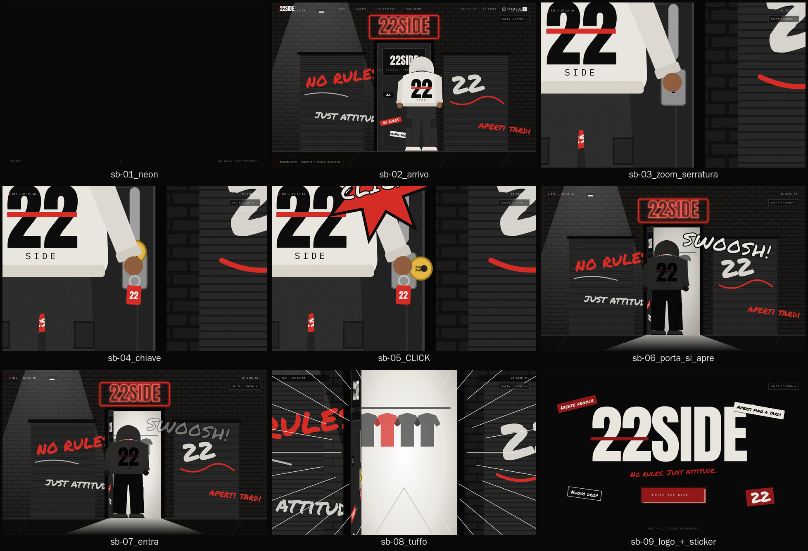

# Intro "La porta e la chiave" — versione salvata

Salvata il 18/11/2026 su richiesta del brand: **da tenere**.
Git tag di riferimento: `intro-porta-chiave-v1` (commit con il sito in italiano + questa intro).



## La scena (≈5,5 s, saltabile)
1. Notte, 22 Side St. — l'insegna al neon **22SIDE** si accende a scatti; saracinesche piene di tag.
2. Un ragazzo di spalle (felpa oversize con **22** sulla schiena, cargo, sneakers) arriva molleggiando alla porta.
3. Zoom di colpo sulla serratura: entra la chiave dorata col portachiavi rosso "22", gira → **CLICK!** + scossa.
4. La porta si spalanca (**SWOOSH!**), la luce del negozio invade il marciapiede, il ragazzo diventa una sagoma.
5. Lui entra, la camera si tuffa dentro la porta (linee di velocità + flash).
6. Logo **22SIDE®** con glitch, sticker trascinabili, CTA *ENTER THE SIDE*.

Si può saltare (pulsante / Esc), non si ripresenta per 12 ore, nel footer c'è "Rivedi l'intro ↻".

## File
Copia congelata in `src/` (stessa struttura del progetto):

| File | Ruolo |
|---|---|
| `components/home/DoorScene.tsx` | la scena SVG + timeline GSAP (tutta l'animazione) |
| `components/home/IntroSequence.tsx` | regia: fasi, salta intro, title card con logo e sticker |
| `components/home/useIntroDone.ts`, `intro-config.ts` | segnale "intro finita" (fa partire l'hero) e durata memoria (12h) |
| `components/ui/Sticker.tsx`, `Logo.tsx` | sticker trascinabili e logo |
| `components/layout/ReplayIntro.tsx` | link "Rivedi l'intro" nel footer |

Dipende anche da: font Permanent Marker + Anton + IBM Plex Mono (`src/app/layout.tsx`), script pre-paint `data-intro` in `layout.tsx`, regola CSS `html[data-intro="seen"] [data-intro-overlay]` in `globals.css`, `<IntroSequence />` in `src/app/page.tsx`.

## Come ripristinarla
Se l'intro viene cambiata e si vuole tornare a questa:

```bash
cp -r archive/intro-porta-chiave/src/* src/
```

oppure, direttamente da git (versione esatta):

```bash
git checkout intro-porta-chiave-v1 -- src/components/home/DoorScene.tsx src/components/home/IntroSequence.tsx src/components/home/useIntroDone.ts src/components/home/intro-config.ts src/components/ui/Sticker.tsx src/components/layout/ReplayIntro.tsx
```

Questa cartella è esclusa da build, TypeScript e lint: è solo un archivio.
